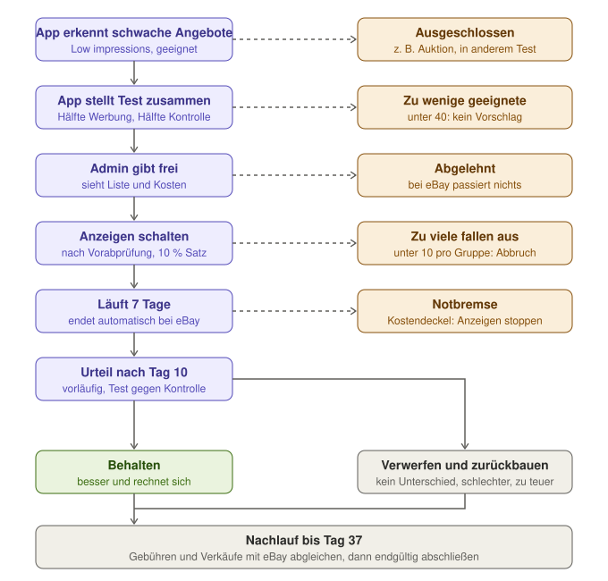

# Funnel: Werbung für schwache Angebote

Entwurf, noch nichts gebaut. Echte eBay-Angebote, **7 Tage** Laufzeit. Die App schlägt dem Admin selbst einen Test vor, nach Freigabe läuft alles automatisch.

**Was geschaltet wird:** eBay Promoted Listings Standard, Werbesatz 10 % vom Verkaufspreis (einstellbar, 2 bis 30 %). Bezahlt wird nur bei einem Verkauf über die Anzeige. Beispiel: 20 €-Artikel, Verkauf über Anzeige, 2 € Gebühr.

## Die Stufen genau

Zahlen in Klammern sind Startwerte und in den Settings einstellbar.

| # | Stufe | Wer | Was genau passiert | Wenn es nicht klappt |
|---|---|---|---|---|
| 1 | **Erkennen** | App, automatisch (täglich) | Ein Angebot ist „schwach" („Low impressions"), wenn es zum untersten Viertel des Shops nach Impressionen der letzten 90 Tage gehört und älter als 90 Tage ist | sonst „OK" oder „Wait" (zu neu), kein Kandidat |
| 2 | **Eignung** | App | Aus den schwachen Angeboten fliegen alle mit Ausschlussgrund raus (Liste unten). Übrig bleibt der **Pool** | Angebot erscheint mit Grund, z. B. „In another test" |
| 3 | **Test zusammenstellen** | App | Ist der Pool ≥ Testgröße (40) und liegt kein anderer Vorschlag offen: zufällige Ziehung von 40, 20 mit Werbung (Testgruppe) und 20 ohne (Kontrolle). Gleicher Seed = gleiche Ziehung. Die App legt den Vorschlag dem Admin vor, mit Preis, Satz und Gebühr je Angebot sowie geschätzten und höchstmöglichen Gesamtkosten | Pool < 40: **kein Vorschlag**, der Admin sieht nur „31 of 40 listings available". Dann Testgröße in den Settings senken (kleinster Wert 4, unter 20 kaum belastbar) oder warten |
| 4 | **Freigabe** | Admin | Bestätigt oder lehnt ab. Er darf Satz und Größe vor dem Bestätigen ändern. Der Vorschlag gilt 7 Tage, danach wird er neu berechnet | abgelehnt: bei eBay passiert nichts, die App schlägt frühestens nach 7 Tagen neu vor |
| 5 | **Vorabprüfung** | App | Beim Bestätigen wird jedes Angebot nochmal bei eBay gelesen (aktiv, Menge > 0, Preis höchstens 5 % anders, nicht schon beworben). Wer durchfällt, wird übersprungen | Bleiben in einer Gruppe weniger als 10 (neue Einstellung „Mindestgröße") übrig: **Abbruch**, nichts wird geschaltet, der Admin sieht den Grund |
| 6 | **Schalten** | App | Kampagne mit Enddatum (Tag 7) und eine Anzeige je Testangebot anlegen, Antwort von eBay je Angebot speichern | Probelauf (Schalter aus), Teilfehler (Angebot „fehler", Rest läuft), Kampagne scheitert (alles zurückgenommen) |
| 7 | **Läuft 7 Tage** | Wächter, täglich | Kosten und Zustand prüfen | Notbremse, siehe „Während des Tests" |
| 8 | **Urteil** (Tag 10) | App | Test gegen Kontrolle, siehe Tabelle unten. Die App benachrichtigt den Admin und zeigt ihm das Ergebnis: Urteil, Diagramme, Kosten, Umsatz | Ausgang je Tabellenzeile |
| 9 | **Abschluss** | Admin | Entscheidet nach Ansicht des Ergebnisses: **Behalten** oder **Verwerfen** | – |
| 10 | **Nachlauf** (bis Tag 37) | App | Gebühren und Verkäufe mit eBay abgleichen, Urteil endgültig | Abweichung wird im Test angezeigt |

**Beispiel Pool:** Der Shop hat 160 Angebote, 120 davon älter als 90 Tage. Das unterste Viertel sind 30. Davon sind 4 in einem laufenden Test, 3 schon beworben, 2 Auktionen: Pool = 21. Bei Testgröße 40 gibt es keinen Test. Bei Testgröße 20 gibt es einen (10 gegen 10, genau die Mindestgröße).

## Mensch oder automatisch

Es gibt keinen Builder-Schritt und keine KI. Die App arbeitet nach festen Regeln.

| Admin (zwei Klicks) | App (automatisch) |
|---|---|
| Freigabe des Vorschlags | Schwache Angebote erkennen, Test zusammenstellen, Vorschlag stellen |
| Am Ende „Behalten" oder „Verwerfen" | Vorabprüfung, Schalten, tägliche Kontrolle mit Notbremse, Anzeigen enden an Tag 7, Urteil an Tag 10, Nachlauf |

Das Urteil ist nur eine Empfehlung. „Behalten" heißt: Der Admin startet die Anzeigen für die Testgruppe bewusst neu (mit neuem Enddatum). Sie laufen nie von selbst weiter. Ohne Entscheidung nach 14 Tagen meldet die App „Test overdue". Builder haben mit Werbetests nichts zu tun.

## Zeitplan

| Zeitpunkt | Was passiert |
|---|---|
| Tag −7 bis −1 | „Vorher"-Zahlen (Impressionen, Verkäufe) |
| Tag 0 | Freigabe, Vorabprüfung bei eBay, Anzeigen starten |
| Tag 0 bis 7 | Läuft. Die Kampagne hat bei eBay ein festes Enddatum (Tag 7), die Werbung stoppt also auch, wenn unser Server ausfällt |
| Tag 10 | Urteil (eBay liefert Zahlen mit 2 bis 3 Tagen Verzug). **Vorläufig** |
| bis Tag 37 | Nachlauf: eBay rechnet Verkäufe bis 30 Tage nach dem Klick der Anzeige zu. Danach Gebühren abgleichen, Urteil endgültig |

## Wer kommt in den Test

Ausgeschlossen werden:
- Auktionen (Promoted Listings gibt es nur für Festpreis), beendete, ausverkaufte oder Angebote ohne Preis oder unter 5 €
- alle Angebote in einem nicht abgeschlossenen Test, egal ob Test- oder Kontrollgruppe, egal ob Titel- oder Werbetest
- Angebote, die schon beworben werden (auch von Hand im Seller Hub oder nach „Behalten")
- Titel, Preis oder Bilder in den letzten 14 Tagen geändert, oder weniger als 14 Tage nach einem beendeten Werbetest
- neue Angebote (Schonfrist), Kategorien, die eBay nicht zulässt, Produkte mit mehreren eBay-Angeboten, die sich nicht eindeutig zuordnen lassen
- mehrere Angebote desselben Produkts kommen immer in dieselbe Gruppe

## Während des Tests

- **Vorabprüfung** direkt vor dem Schalten: Angebot aktiv, Menge > 0, Preis höchstens 5 % anders als beim Vorschlag, nicht schon beworben. Wer durchfällt, wird übersprungen. Weniger als 10 pro Gruppe: Abbruch (siehe Stufe 5).
- **Kosten sind bei eBay nicht begrenzt** (kein Tagesbudget). Unser Wächter prüft täglich den Kostendeckel (Start 50 €) und stoppt bei Überschreitung. Eine zusätzliche Grenze: Gebühren über 50 % des Anzeigenumsatzes nach 10 Verkäufen = Stopp.
- Preis geändert, Angebot beendet oder Anzeige abgelehnt: Angebot fällt aus dem Urteil. Fallen mehr als 30 % einer Gruppe aus, ist der Test ungültig.
- Satz von Hand im Seller Hub geändert: nicht überschreiben, melden. eBay nicht erreichbar: nichts auf Verdacht tun, nach 3 Tagen Meldung.
- Wächter läuft nicht: keine Notbremse. Das Enddatum bei eBay ist dann die Absicherung.

## Urteil

Vergleich Test gegen Kontrolle: mindestens +20 % Impressionen **und** bei mehr als der Hälfte der Testangebote steigen die Impressionen (eine Woche ist unruhig, ein Ausreißer soll nicht entscheiden). Verkäufe dürfen nicht mehr als 20 % schlechter sein. Neu: der Mehrumsatz muss größer sein als die Gebühren.

| Impressionen | Verkäufe | Rechnet sich | Ausgang | Empfehlung |
|---|---|---|---|---|
| ≥ +20 %, Mehrheit steigt | ok | ja | better | behalten |
| ≥ +20 %, Mehrheit steigt | ok | nein | costs more than it brings | verwerfen |
| ≥ +20 % | zu niedrig | egal | worse | verwerfen |
| −20 % bis +20 % | egal | egal | no difference | verwerfen |
| ≤ −20 % | egal | egal | worse | verwerfen |
| unter 100 Impressionen in der Testgruppe | | | not enough data | verwerfen |

Unter 10 Verkäufen über Anzeige gilt die Wirtschaftlichkeit als „zu wenig Daten", nicht als „zu teuer". Bezahlte und natürliche Impressionen werden getrennt ausgewiesen. Liegt 10 % unter dem, was Wettbewerber in der Kategorie bieten, wird die Anzeige kaum gezeigt und der Test sagt „no difference". Der Admin entscheidet am Ende. „Behalten" gilt nur für die Testgruppe, eine Ausweitung ist ein neuer Vorschlag mit neuer Freigabe. „Verwerfen" entfernt Anzeigen und Kampagne und prüft bei eBay nach.

## Tests (ohne echtes eBay, mit Fake-eBay)

- **Eignung:** jeder Ausschlussgrund einzeln, Kontrollgruppe eines laufenden Tests wird auch ausgeschlossen, Pause nach beendetem Test, gleiche Produkte in einer Gruppe
- **Vorschlag und Rechte:** App stellt nur einen Vorschlag zur Zeit, kein Vorschlag bei Pool < 40, Vorschlag verfällt nach 7 Tagen, nach Ablehnung 7 Tage Pause; gleiche Seed = gleiche Aufteilung, Kontrolle bekommt nie Werbung, Satz außerhalb 2 bis 30 % abgelehnt, Builder und Nicht-Admins können nicht freigeben (403), ohne Login 401, Ablehnung = 0 eBay-Aufrufe, Doppelklick schaltet nur einmal
- **Schalten:** Schalter aus = Probelauf ohne Schreibaufruf, eBay lehnt ein Angebot ab, Preis seit Freigabe geändert, Kampagne scheitert (kein Halbzustand), Token abgelaufen (Wiederholung ohne Doppelschaltung), Enddatum ist gesetzt
- **Laufzeit:** Kostendeckel, Gebühren-Anteil, Ausfall über 30 %, Preisänderung, von Hand geänderter Satz, eBay nicht erreichbar
- **Urteil:** jede Tabellenzeile, genau +20,0 %, Kontrolle mit 0 vorher, ein Ausreißer kippt das Urteil nicht, Mehrheitsregel
- **Nachlauf und Abschluss:** Urteil bleibt vorläufig bis Tag 37, Storno erstattet Gebühr, behalten löscht nichts, verwerfen entfernt alles, Rückbau teilweise fehlgeschlagen bleibt offen, zweimal abschließen = 409

## Bauplan

1. `app/werbung.mjs`: Eignung, Kosten, Notbremsen-Regeln (nur Rechnung)
2. `app/ebay-werbung.mjs`: eBay-Marketing-API (Kampagne mit Enddatum, Anzeigen, Berichte) mit Probelauf, plus **Tageszahlen der Impressionen** (siehe unten)
3. Erweiterung `experimente.mjs`, `freigabe.mjs`, neue Tabellen
4. Wächter täglich, Urteil mit Wirtschaftlichkeit, Diagramme
5. Oberfläche, Beispielansicht, README
6. **Pilot vor dem ersten echten Test:** 3 bis 5 eigene Angebote, nur um zu sehen, dass Anzeigen erscheinen, der Satz reicht und alles sauber endet. Ohne Urteil.

## Zu klären

- **Datenbasis:** Die App kennt heute nur 30-Tage-Summen. Für 7 Tage braucht sie Tageszahlen von eBay (Analytics API, Traffic-Bericht je Tag) oder muss Zahlen selbst täglich speichern. Das ist der größte Zusatzaufwand.
- **Eine Woche ist wenig:** Schwache Angebote haben wenig Impressionen, oft ist das Urteil dann „not enough data". Besser die Gruppe größer machen (alle schwachen Angebote) als länger laufen lassen.
- **Marge:** Reicht 10 % plus eBay-Gebühren noch für Gewinn? Vorschlag: Einstellung „Mindestmarge".
- **eBay-Zugang:** Token braucht `sell.marketing`, das erteilt der Admin bei eBay neu. Echte Werbung geht nur auf dem Produktivserver (Vorschau hat keine eBay-Zugangsdaten).
- API-Details (Pflichtfelder, Mindestsatz, Kategorien, Richtwert-Satz) vor dem Bauen gegen die aktuelle eBay-Doku prüfen.
